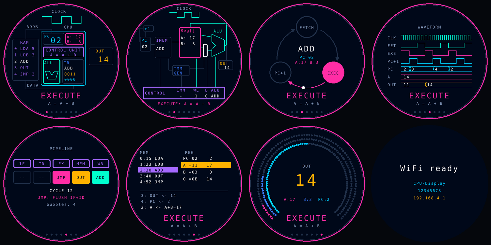
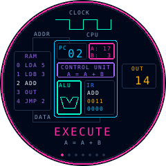
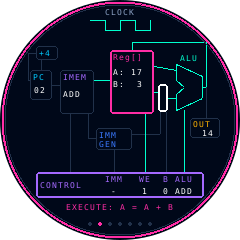
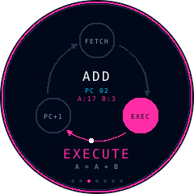
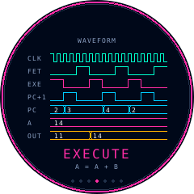
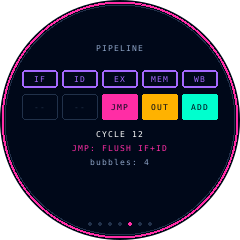
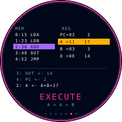
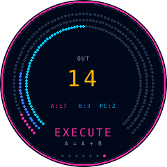
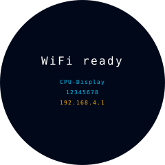

<div align="center">

# 🧠 tinycpu

**An 8-bit accumulator CPU that runs in slow motion on a 1.28" round LCD — drawn seven different ways, and mirrored live in your phone's browser over WiFi.**




</div>

---

## 📖 What this is

A teaching toy. It simulates an **8-bit accumulator CPU** at about one instruction per second and draws what the machine is doing onto a round display. One button cycles seven views of the *same* running program, so you can watch a single instruction as a block diagram, then a datapath, then a state machine, then a waveform.

It also brings up its own **WiFi access point** and serves a single-page web UI. The browser draws a pixel-accurate twin of the round display on a canvas, and adds what a 240×240 screen has no room for: register cards, an execution log, and an editable program. Edit an instruction in the browser and the hardware picks it up on the next poll.

Nothing is pre-recorded — every view is driven by the same simulated registers.

---

## 📺 The seven views

| | | |
|:--:|:--:|:--:|
|  |  |  |
| **0 · Blocks** — RAM, control unit, PC, ALU, IR and OUT, with the address and data buses lighting up as they are used | **1 · Datapath** — a single-cycle RISC-style datapath with the live control-signal table (`IMM`, `WE`, `B`, `ALU`) | **2 · FSM** — the three phases as nodes on a circle, with a dot travelling the active arc in real time |
|  |  |  |
| **3 · Waveform** — a logic-analyser strip: `CLK`, the three phase signals, and `PC`, `A`, `OUT` as bus traces | **4 · Pipeline** — a 5-stage `IF/ID/EX/MEM/WB` diagram with the flush a taken `JMP` causes | **5 · Debug** — memory with the `PC` row highlighted, the register being written highlighted, and a scrolling log |
|  |  | |
| **6 · Radial** — a large `OUT` readout with concentric arc gauges for `A`, `B` and `PC` | **Boot** — the AP name, password and address, held for five seconds at startup | |

> These are renderings produced from the sketch's own drawing code, not photographs of the panel. Colours are the RGB565 constants decoded exactly as the display receives them.

> **Note on the pipeline view.** The simulated CPU is a three-phase sequencer, not a pipelined machine. Page 4 runs its own model over the same program to show what a pipelined version *would* do, including the two-instruction flush on a taken branch. It is a demonstration, not a readout of the executing core.

---

## 📶 The web UI

On boot the board starts a WiFi access point and prints the details on screen:

| | |
|---|---|
| SSID | `CPU-Display` |
| Password | `12345678` |
| Address | `http://192.168.4.1` |

Join it from a phone or laptop and open the address. The page:

- draws the **same seven pages** on a canvas, from the same drawing routines, scaled 2× for a crisp display
- has **page tabs** and a BOOT button, and flipping a page in the browser flips it on the hardware
- shows **PC / A / B / OUT** as large cards, plus a running **execution log**
- lets you **edit the program** — pick a mnemonic and an operand per address and the change is pushed to the board
- can **pause, single-step, reset**, and change the clock speed from 0.25× to 4×
- follows the system light or dark theme, and responds to `space`, `←` and `→`

The page is served from `PROGMEM` as one self-contained file: no CDN, no external assets, so it works on an AP with no internet. Captive-portal probes for Android (`/generate_204`) and iOS (`/hotspot-detect.html`) are answered so the "sign in to network" sheet behaves.

If the board is unreachable the page keeps running its own simulation in the browser and shows *Offline, reconnecting* — so you can try the UI with no hardware at all.

### HTTP interface

| Route | Purpose |
|---|---|
| `GET /` | the UI |
| `GET /s` | state: `seq,ph,pc,A,B,out,ir,ia,page,paused,arg[0..4],op[0..4]` |
| `GET /c?a=…` | commands: `page&v=`, `pause&v=`, `step`, `reset`, `speed&v=`, `prog&i=&o=&g=` |

The browser polls `/s` every 100 ms and only redraws when the sequence number changes.

---

## 🧮 The CPU

Five instructions, one accumulator (`A`), one operand register (`B`), a program counter and an output latch.

| Opcode | Mnemonic | Micro-operation |
|---|---|---|
| `1` | `LDA n` | `A ← n` |
| `2` | `LDB n` | `B ← n` |
| `3` | `ADD` | `A ← A + B` |
| `4` | `OUT` | `OUT ← A` |
| `5` | `JMP n` | `PC ← n` |

**Instruction format** — one byte, split into nibbles:

```
 7   6   5   4   3   2   1   0
┌───────────────┬───────────────┐
│    opcode     │    operand    │
└───────────────┴───────────────┘
```

### The default program

| Addr | Byte | Instruction | Effect |
|---|---|---|---|
| 0 | `0x15` | `LDA 5` | `A ← 5` |
| 1 | `0x23` | `LDB 3` | `B ← 3` |
| 2 | `0x30` | `ADD` | `A ← A + B` |
| 3 | `0x40` | `OUT` | `OUT ← A` |
| 4 | `0x52` | `JMP 2` | `PC ← 2` |

The jump makes addresses 2–4 a loop, so after the two loads the accumulator climbs by `B` every pass: **OUT shows 8, 11, 14, 17, 20 …**, wrapping at 256 because the registers are 8-bit. A counter that counts by three — deliberately dull, so the *visualisation* is the interesting part. Change `LDB` in the browser and it counts by something else.

### Timing

Each instruction runs as **three phases of 320 ms** — `FETCH` → `EXECUTE` → `PC+1`. The simulated clock toggles every 80 ms, four edges per phase, and the last 36 samples feed the waveform view. The speed slider scales the inner delay from 0.25× to 4×.

---

## 🔌 Hardware

- **ESP32-C3 Super Mini** (or Seeed XIAO ESP32-C3)
- **GC9A01** 1.28" 240×240 round IPS LCD, SPI
- One momentary push button

| Display pin | ESP32-C3 |
|---|---|
| VCC | 3V3 |
| GND | GND |
| RST | GPIO 0 |
| CS | GPIO 1 |
| DC | GPIO 10 |
| SDA (MOSI) | GPIO 3 |
| SCL (SCK) | GPIO 4 |

| Other | ESP32-C3 |
|---|---|
| Page button | GPIO 9 → GND |

Power the display from **3V3, not 5V**. If the module has a `BL` pin, tie it to 3V3. SPI runs at 40 MHz, so keep the wires short and firmly seated.

> ⚠️ **GPIO 9 is the BOOT strapping pin** on the ESP32-C3. Using it for the page button means no extra hardware — the onboard BOOT button works directly — but holding it down while the board resets puts the chip into download mode instead of running the sketch. Move the button to another free pin if that gets in your way.

> 📡 **Antenna workaround.** `WiFi.setTxPower(WIFI_POWER_8_5dBm)` after `softAP()` is deliberate: many ESP32-C3 Super Mini boards have a poorly matched PCB antenna and drop clients at full transmit power. Lowering it trades range for a connection that stays up.

---

## ▶️ Building

Needs the **[GFX Library for Arduino](https://github.com/moononournation/Arduino_GFX)** by moononournation.

**Arduino IDE**

1. Install the `esp32` board package by Espressif through Boards Manager.
2. Install `GFX Library for Arduino` through Library Manager.
3. Keep `tinycpu.ino` in a folder called `tinycpu` — cloning this repo already gives you that.
4. Board: **ESP32C3 Dev Module**, with **USB CDC On Boot: Enabled**.

**PlatformIO**

```ini
[env:esp32c3]
platform = https://github.com/pioarduino/platform-espressif32/releases/download/stable/platform-espressif32.zip
board = esp32-c3-devkitm-1
framework = arduino
monitor_speed = 115200
lib_deps = moononournation/GFX Library for Arduino
build_flags =
    -DARDUINO_USB_MODE=1
    -DARDUINO_USB_CDC_ON_BOOT=1
```

The current GFX library needs Arduino-ESP32 core 3.x. The stock `espressif32` platform ships core 2.x and fails with `esp32-hal-periman.h` / `esp_private/periph_ctrl.h` not found — use the pioarduino platform above, or pin the library to an older release such as `@1.4.9`.

---

## 🎨 Changing the program

At runtime, use the browser. In the source, the program is two arrays:

```cpp
uint8_t op[]  = {0, 1, 2, 3, 4};   // opcode per address
uint8_t arg[] = {5, 3, 0, 0, 2};   // operand per address
```

Adding an instruction means extending `nm`, `micro` and `lf`, bumping `N`, and adding a case to the `switch` in `loop()`. Phase length is the `wait(320)` calls; the clock period is the `ms / 80` divisor inside `wait()`.

---

## 🗂 Repository layout

```
tinycpu.ino    the sketch, with the web UI embedded in PROGMEM
webui.html     the same page extracted, to open in a browser without hardware
docs/          screen renderings generated from the drawing code
```

---

<div align="center">

Built by [**Fahim Islam**](https://github.com/fahim-islam15) · EEE @ AIUB

</div>
